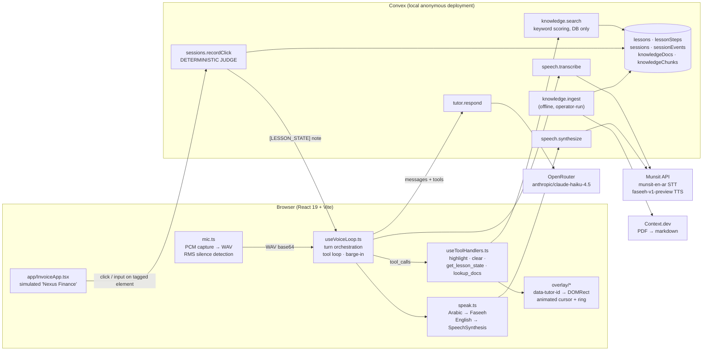

# Guidr — AI voice tutor for real-world software tasks

Guidr is a browser-based, voice-only tutor that walks a learner through a real workplace
task one step at a time. It listens in English, Arabic, or code-switched Arabic-English,
reasons with Claude, points at the exact control to use, and speaks its guidance aloud —
while a deterministic backend, not the LLM, decides whether each step was actually done.

Built during a Devin hackathon, where it won first place. Internal codename: **Clicky-UAE**
(you will see this in `package.json`, `AGENTS.md` and the `localStorage` key).

> **Status:** hackathon MVP. One lesson is implemented end to end: creating a supplier
> invoice in a simulated accounts-payable dashboard ("Nexus Finance"). See
> [Limitations](#current-limitations) before relying on anything here.

---

## Table of contents

- [The problem](#the-problem)
- [What Guidr does](#what-guidr-does)
- [Architecture](#architecture)
- [How the AI works](#how-the-ai-works)
- [Tech stack](#tech-stack)
- [Repository layout](#repository-layout)
- [Running locally](#running-locally)
- [Environment variables](#environment-variables)
- [Hackathon](#hackathon)
- [Current limitations](#current-limitations)
- [Future work](#future-work)

---

## The problem

Onboarding people onto workplace software is usually a screenshot PDF, a recorded video,
or a colleague leaning over a shoulder. None of those adapt to the learner, none of them
can answer a question mid-task, and none of them speak the learner's language — which in
the UAE is often a fluid mix of Arabic and English within a single sentence.

Generic LLM chatbots do not solve this either. They cannot see the screen, they cannot
point at anything, and — most importantly — they will cheerfully tell a learner "great,
you've done it!" when nothing has happened.

Guidr's target users are white-collar workers in the UAE (the demo persona is a
Finance Assistant in Accounts Payable in Dubai) who need to learn a concrete task in a
line-of-business application and would rather be *talked through it* than read about it.

## What Guidr does

Everything below is implemented in this repository.

- **Voice in, voice out, no text chat.** The learner clicks the mic and speaks; Guidr
  replies with synthesized speech. There is no text input anywhere in the UI.
- **Arabic / English / code-switched speech recognition** via Munsit's `munsit-en-ar`
  model, which is specifically built for mixed Arabic-English audio.
- **Language mirroring.** The learner's language is detected per utterance
  (`en` / `ar` / `mixed`) and Claude is told explicitly, every turn, which language to
  reply in. Arabic replies are spoken by Munsit's Faseeh engine in an Emirati dialect;
  English replies use the browser's `SpeechSynthesis`.
- **Pointing, not coordinates.** Claude can call `highlight_element` with a *semantic*
  element id (e.g. `supplier-dropdown`). The browser resolves that id to a live DOM rect
  and animates a cursor to it. No tool accepts an x/y value.
- **Deterministic progress.** Every click or input on a tagged control is sent to a
  Convex mutation (`sessions.recordClick`) that compares it against the current step's
  expected element and completion rule. Only that mutation can advance the lesson. The
  LLM has no tool that can.
- **Teach, don't just point.** The system prompt requires every instruction to contain
  an *action*, its *meaning*, and a concrete *reason* it matters for the learner's work.
- **Grounded answers from official docs.** A `lookup_docs` tool retrieves chunks from the
  UAE Federal Tax Authority's VAT11 "Tax invoices" guide, ingested once through
  Context.dev and cached in Convex. The live voice turn never hits an external
  documentation API.
- **Confirmation before consequential actions.** Before the final "Submit Invoice" step
  the tutor must read back the known details and get a verbal yes.
- **Barge-in.** Holding `Ctrl+Space` while the tutor is speaking stops playback, captures
  audio for as long as the keys are held, and submits on release.
- **Resumable sessions.** Progress lives in Convex; a page refresh resumes from the
  persisted step with a `[LESSON_STATE] resumed` note to the tutor.
- **Graceful degradation.** After two consecutive Munsit STT failures the loop switches
  to the browser's `SpeechRecognition`; if Munsit TTS fails, speech falls back to
  `SpeechSynthesis`. A visible "fallback STT" badge appears when this happens.
- **Audit trail.** Every step start, correct/wrong action, hint, doc lookup and
  completion is written to a `sessionEvents` table.

## Architecture



### The core rule: the LLM never decides whether the learner succeeded

This is the single most important design decision in the codebase, and almost everything
else follows from it.

| Concern | Owner |
|---|---|
| Arabic / code-switched speech recognition | Munsit `munsit-en-ar` via [`convex/speech.ts`](convex/speech.ts) `transcribe` |
| Reasoning, tone, language mirroring, tool calls | Claude via OpenRouter in [`convex/tutor.ts`](convex/tutor.ts) `respond` |
| Speech output | Munsit Faseeh (Arabic) / browser `SpeechSynthesis` (English) in [`src/voice/speak.ts`](src/voice/speak.ts) |
| "Was that click correct? Which step are we on?" | [`convex/sessions.ts`](convex/sessions.ts) `recordClick` — pure, deterministic |
| Pixel position of a control | [`src/overlay/useElementRect.ts`](src/overlay/useElementRect.ts) via `[data-tutor-id]` + `getBoundingClientRect` |
| Durable progress, lessons, knowledge | Convex tables ([`convex/schema.ts`](convex/schema.ts)) |
| External documentation | Context.dev, ingested once offline, cached in Convex |

Concrete consequences you can verify in the code:

- There is **no `advance_step` tool**. The tool list in
  [`src/contracts/tools.ts`](src/contracts/tools.ts) is exactly `highlight_element`,
  `clear_highlight`, `get_lesson_state`, `lookup_docs`.
- **No tool schema accepts a number** that could be interpreted as a coordinate.
  `highlight_element` takes an `elementId` from a closed enum built from the element
  registry.
- Lesson progress is **read from a reactive Convex query** (`sessions.get`) and never
  mirrored into React state, so a refresh cannot desynchronise the UI from the truth.
- Application state flows *to* the model through `[LESSON_STATE]` user-role messages
  built in [`src/voice/notifyAgent.ts`](src/voice/notifyAgent.ts). The model can
  receive these but cannot emit them — that asymmetry is what stops it from ever
  declaring success on its own.

### The deterministic loop

1. The learner clicks or types in the simulated app. Every meaningful control carries a
   `data-tutor-id` attribute from a frozen registry
   ([`src/contracts/elements.data.ts`](src/contracts/elements.data.ts)). Decoy controls
   (Tax Rate, Attach File, Discard) are tagged too, so wrong clicks are detectable, but
   they are excluded from the set the tutor may highlight.
2. [`LessonRuntime.tsx`](src/lesson/LessonRuntime.tsx) forwards the element id (and the
   input value, if any) to `sessions.recordClick`.
3. `recordClick` loads the current `lessonSteps` row and checks `step.elementId ===
   clicked && meetsCompletionRule(step, value)`. Completion rules are one of
   `{ kind: "click" }`, `{ kind: "select", expectedValue }`, or
   `{ kind: "input", minLength }`. A correct action increments `currentStepIndex`
   (and marks the session `completed` on the last step); a wrong one increments
   `wrongClicks`. Both are logged to `sessionEvents`.
4. The result (`correct` / `wrong` / `already_done`, plus the next step) is turned into a
   `[LESSON_STATE]` message and appended to the conversation, and the tutor is asked to
   respond. The tutor is *told* what happened; it is never *asked* whether it was right.

### The voice pipeline

Orchestrated by [`src/voice/useVoiceLoop.ts`](src/voice/useVoiceLoop.ts) in three
stages:

1. **Capture** — [`mic.ts`](src/voice/mic.ts) pulls raw PCM through a
   `ScriptProcessorNode`, computes a smoothed RMS for voice-activity detection
   (speech starts above `0.018` RMS, ends after `900 ms` of silence, min `350 ms`, max
   `15 s`), and encodes 16-bit mono WAV in the browser. WAV was chosen over
   `MediaRecorder` to avoid container/codec negotiation with Munsit, and the same sample
   buffer provides the level meter for free. Ordinary turns are click-to-talk; the mic is
   paused while the tutor speaks so it never transcribes its own audio.
2. **Understand + reason** — the WAV is base64-encoded and sent to `speech.transcribe`
   (Munsit). The transcript is appended as a `user` message and `tutor.respond` is called
   with the full history. If Claude returns `tool_calls`, each is executed in the browser
   by [`toolDispatcher.ts`](src/voice/toolDispatcher.ts) and answered with a
   `role: "tool"` message before the next request — bounded by `MAX_TOOL_ROUNDS = 6`.
3. **Speak** — [`speak.ts`](src/voice/speak.ts) routes by script. Any Arabic in the reply
   goes to Munsit Faseeh *as a whole*, which keeps a mixed Arabic-English sentence in one
   voice and preserves intra-sentence code-switching. Pure English goes to the browser.

**Interruption handling.** A turn-version counter invalidates any in-flight Claude or TTS
result when the learner barges in. A "protocol barrier" promise ensures that if the
interruption lands mid-tool-loop, the pending tool results are written *before* the new
learner message, because OpenRouter rejects a conversation with an unanswered
`tool_call`. [`runToolCall`](src/voice/toolDispatcher.ts) is written so it can never
reject: unknown tools, unparseable arguments, thrown handlers and a 2.5 s watchdog all
produce a `{ ok: false, error }` tool result instead of a missing one.

### Why the API keys are proxied through Convex

Munsit has no ephemeral-token mechanism, and its browser WebSocket auth puts the raw key
in the URL. The only way to keep `MUNSIT_API_KEY`, the OpenRouter key and
`CONTEXT_DEV_API_KEY` out of the browser bundle is to make every call from a Convex
action. No action ever returns a key to the client, and nothing secret is ever
`VITE_`-prefixed (Vite inlines those into the bundle).

## How the AI works

### Model and transport

- **Model:** `anthropic/claude-haiku-4.5` by default (`DEFAULT_MODEL` in
  [`convex/tutor.ts`](convex/tutor.ts)), chosen for latency and cost on short tutor
  turns. Override with the `ANTHROPIC_MODEL` Convex env var (e.g.
  `anthropic/claude-sonnet-4.5`).
- **Transport:** OpenRouter's OpenAI-compatible `/chat/completions` endpoint. Because of
  this, the wire format is OpenAI-style (`tool_calls` / `role: "tool"`), not Anthropic's
  native `tool_use` / `tool_result`.
- **Request shape:** `max_tokens: 400`, `tool_choice: "auto"`, a single `system` message
  (`TUTOR_INSTRUCTIONS`) followed by the full conversation history maintained in the
  browser. The Convex action is stateless; the browser owns the message list because the
  `highlight_element` tool has to touch the DOM.

### System prompt

[`convex/prompts.ts`](convex/prompts.ts) holds `TUTOR_INSTRUCTIONS`. It is server-side
only and is never shipped to the browser. Notable sections:

- **Spoken-output constraints** — no markdown, lists, emoji or parentheses; one or two
  short sentences; one instruction or question per turn; numbers written as words.
- **Language rule** — mirror the learner's most recent utterance. `[LESSON_STATE]` notes
  are always English and are explicitly flagged as *not* evidence of the learner's
  language; each note carries a language directive appended by
  [`languageDirective()`](src/voice/notifyAgent.ts).
- **Learning contract** — every guided action must include action + meaning + reason,
  then a `highlight_element` call, then stop.
- **Grounding** — the model is told it cannot see the screen, must not claim to have
  observed a click, and must never declare success until a `[LESSON_STATE]` note says so.
- **Consequential action** — before the submit step, read back known details (supplier,
  amount) and ask for one verbal confirmation; the description text is deliberately *not*
  given to the model so it cannot invent it.
- **Element catalogue** — the list of highlightable ids with English and Arabic labels is
  generated from the registry at module load, so prompt and tool enum can never drift
  from each other.

### Tools (OpenAI function-calling format)

| Tool | Arguments | What it does |
|---|---|---|
| `highlight_element` | `elementId` (enum), `style?: "cursor" \| "pulse"` | Resolves the id to a DOM node and animates a ring + cursor to it. Returns `found`, bilingual labels, and `isCurrentStepTarget`. Does **not** click or advance. |
| `clear_highlight` | — | Removes the overlay. |
| `get_lesson_state` | — | Returns the latest reactive `LessonStateSnapshot` (step index, total steps, target element, counters). |
| `lookup_docs` | `query` (English) | Runs `knowledge.search` against cached FTA guidance chunks. Logs a `doc_lookup` event. |

Tool handlers are defined in [`src/lesson/useToolHandlers.ts`](src/lesson/useToolHandlers.ts)
and read live state through refs so the model never sees stale progress.

### Knowledge layer (retrieval)

Implemented in [`convex/knowledge.ts`](convex/knowledge.ts).

- **Ingest (offline, operator-triggered):** `knowledge.ingest` fetches the FTA VAT11
  "Tax invoices" PDF through Context.dev's `web/scrape/markdown` endpoint, which converts
  it to markdown server-side. One retry on 429/5xx. A 24-hour cache guard on
  `knowledgeDocs` prevents repeat fetches. `knowledge.ingestFixture` pushes a committed
  snapshot ([`convex/fixtures/ftaTaxInvoice.ts`](convex/fixtures/ftaTaxInvoice.ts))
  through the identical chunker and upsert path for offline/no-credit demos.
- **Chunking:** split on `##`/`###` headings (and later `#` headings, since PDF→markdown
  often emits only those), hard-capped at 1,200 characters with paragraph → sentence →
  word-boundary fallback, chunks under 80 characters dropped as boilerplate. Each chunk
  gets a Unicode-aware keyword list (stopwords removed, tokens ≥ 3 chars) and a
  heuristic `relatedStepIndex`.
- **Search (live turn):** a plain Convex query. Score = `2` per query token in the
  chunk's keywords, `+1.5` per token in the heading, `+1` for a raw substring match.
  Top-3 by default. **No embeddings, no vector index, no LLM call** — deliberately dumb
  and fast, and it reads the database only.

### Agentic flow of one turn

```
learner speaks
  └─ mic.ts detects utterance → WAV → base64
       └─ speech.transcribe (Munsit munsit-en-ar) → text
            └─ detectLanguage(text) → "en" | "ar" | "mixed"
            └─ append { role: "user", content: text }
                 └─ tutor.respond(messages) → Claude via OpenRouter
                      ├─ tool_calls? → runToolCall(...) for each → append role:"tool" → loop (≤ 6)
                      └─ content → speak(): Arabic → Faseeh | English → SpeechSynthesis

learner clicks a tagged control
  └─ sessions.recordClick(elementId, value) → correct | wrong | already_done
       └─ buildStateMessage(...) → "[LESSON_STATE] ..." + languageDirective
            └─ append as role:"user" (hidden from transcript) → tutor.respond(...)
```

## Tech stack

| Technology | Role in Guidr |
|---|---|
| **React 19 + TypeScript** | UI, voice loop hooks, simulated app, overlay. Strict types; the element registry drives compile-time-checked ids across browser *and* Convex code. |
| **Vite 8** | Dev server and bundler. `VITE_`-prefixed env vars are inlined into the bundle, which is why secrets are never given that prefix. |
| **Convex 1.45** | Backend: reactive database (lessons, steps, sessions, events, knowledge), mutations for deterministic progress, actions that proxy Munsit / OpenRouter / Context.dev so keys stay server-side. Runs as an **anonymous local deployment** — no account required. |
| **OpenRouter → Claude** | Tutor reasoning and tool calling. `anthropic/claude-haiku-4.5` by default. |
| **Munsit** (CNTXT) | `munsit-en-ar` for Arabic/English/code-switched STT; `faseeh-v1-preview` for Arabic TTS with `dialect: "emirati"`. |
| **Context.dev** | One-off PDF → markdown conversion of the FTA guide during ingest. Never called on a voice turn. |
| **Web Audio API** | `ScriptProcessorNode` PCM capture, in-browser WAV encoding, RMS-based turn detection. |
| **Web Speech API** | `SpeechSynthesis` for English output; `SpeechRecognition` as STT fallback only. |
| **oxlint** | Linting. |

Runtime dependencies are exactly `convex`, `react`, `react-dom`. There is no LangChain,
no agent framework, no Docker and no auth.

## Repository layout

```
convex/
  schema.ts          Tables + completion-rule union (frozen after Phase 1)
  sessions.ts        start / get / recordClick (the deterministic judge) / recordHint / recordDocLookup
  tutor.ts           Claude via OpenRouter — stateless reasoning action
  prompts.ts         TUTOR_INSTRUCTIONS system prompt + TUTOR_TOOLS schemas
  speech.ts          Munsit STT / TTS / listVoices proxies
  knowledge.ts       Context.dev ingest, chunker, keyword search
  lessons.ts         Lesson/step query helpers
  events.ts          sessionEvents logging + timeline query
  seed.ts            The 5-step "create-supplier-invoice" lesson
  fixtures/          Committed FTA guidance snapshot for offline ingest
src/
  contracts/         Frozen shared types: element registry, tool interfaces, session shapes
  voice/             mic.ts · speak.ts · browserStt.ts · toolDispatcher.ts · notifyAgent.ts · useVoiceLoop.ts
  lesson/            LessonRuntime.tsx (integration) · useLessonSession.ts · useToolHandlers.ts
  overlay/           HighlightProvider · HighlightOverlay · useElementRect
  app/               Simulated "Nexus Finance" invoicing app (UI theatre only)
  ui/                MicButton · StatusPill · StepTracker
  dev/Playground.tsx UI/overlay harness at /?playground, no Convex or voice
scripts/ingest-docs.md   Runbook for the knowledge ingest
AGENTS.md                Architecture rules and conventions for AI coding agents working on this repo
```

## Running locally

Prerequisites: Node.js (developed on v24), a Munsit API key, and an OpenRouter API key.
A Context.dev key is optional — a committed fixture covers the knowledge layer without it.

```bash
npm install

# 1. Start Convex (provisions an anonymous local deployment on first run and writes
#    VITE_CONVEX_URL / VITE_CONVEX_SITE_URL to .env.local). Keep this running.
npx convex dev

# 2. In a second terminal, set the secrets on the Convex deployment. Never put these in .env*.
npx convex env set ANTHROPIC_API_KEY sk-or-v1-...    # an OpenRouter key — see note below
npx convex env set MUNSIT_API_KEY <munsit key>
npx convex env set CONTEXT_DEV_API_KEY ctxt_secret_... # optional

# 3. Seed the lesson and the knowledge base.
npx convex run seed:seedInvoiceLesson
npx convex run knowledge:ingestFixture               # offline snapshot, no credits
#   or, with a Context.dev key:
# npx convex run knowledge:ingest

# 4. Start the app.
npm run dev
```

Open `http://localhost:5173`, click **Click to talk**, allow the microphone, and speak in
English or Arabic. The UI/overlay playground (no voice, no Convex) is at
`http://localhost:5173/?playground`.

Other commands:

```bash
npm run typecheck     # tsc for the frontend and for convex/
npm run lint          # oxlint
npm run build         # tsc -b && vite build
npx convex run speech:listVoices                 # discover valid MUNSIT_VOICE_ID values
npx convex run knowledge:search '{"query":"is the supplier TRN required"}'
```

> **Windows / PowerShell:** if the execution policy blocks `npm.ps1`, call `npm.cmd` /
> `npx.cmd` instead (e.g. `& "C:\Program Files\nodejs\npx.cmd" convex dev`). Do not
> change the execution policy. See `AGENTS.md` and `scripts/ingest-docs.md`.

> **Browser:** the mic path uses `ScriptProcessorNode` and the fallback STT uses
> `webkitSpeechRecognition`; the project was developed and tested in current Chrome/Edge.

## Environment variables

**Public (`.env.local`, written by `npx convex dev`):**

| Variable | Purpose |
|---|---|
| `VITE_CONVEX_URL` | Convex client URL for queries, mutations and actions (`http://127.0.0.1:3210` locally). |
| `VITE_CONVEX_SITE_URL` | Convex HTTP-actions URL (`http://127.0.0.1:3211`). Written by the CLI; not currently used by the app. |

**Secrets (Convex env vars only — `npx convex env set`):**

| Variable | Required | Purpose |
|---|---|---|
| `ANTHROPIC_API_KEY` | Yes | Bearer token for OpenRouter. **Despite the name, this must be an OpenRouter key** (`sk-or-v1-…`); the code calls `https://openrouter.ai/api/v1/chat/completions`. |
| `MUNSIT_API_KEY` | Yes | Munsit STT + TTS. |
| `CONTEXT_DEV_API_KEY` | No | Only needed for `knowledge:ingest`. Use `knowledge:ingestFixture` otherwise. |

**Optional tuning (Convex env vars):**

| Variable | Default | Purpose |
|---|---|---|
| `ANTHROPIC_MODEL` | `anthropic/claude-haiku-4.5` | OpenRouter model id for the tutor. |
| `MUNSIT_STT_MODEL` | `munsit-en-ar` | Munsit transcription model. |
| `MUNSIT_VOICE_ID` | `ar-najdi-male-2` | Faseeh voice. Run `speech:listVoices` to see options. |
| `MUNSIT_DIALECT` | `emirati` | Faseeh dialect. |

`.env*` files are gitignored except `.env.example`.

## Hackathon

Guidr was built during a Devin hackathon and **won the hackathon**. The git history shows
the build in phases over a single day, with commits co-authored by Devin:

1. **Phase 1 — frozen foundation.** Convex schema, element registry, tool contracts and
   session shapes were written first and then frozen, so parallel workstreams (data,
   voice, knowledge, UI, integration) could proceed without colliding.
2. **Phase 2 — voice transport, knowledge layer, simulated app and overlay.**
3. **Phase 3 — closing the deterministic loop end to end.**
4. **Re-architecture: Claude + Munsit instead of OpenAI Realtime.** The original plan used
   OpenAI's speech-to-speech Realtime API over WebRTC. Without OpenAI access, the
   transport was replaced by the current three-stage STT → LLM → TTS pipeline. Because
   the contracts were frozen, the schema, `recordClick`, element registry, tool
   interfaces, simulated app, overlay and knowledge layer all survived unchanged — only
   the transport moved.
5. **Routing Claude through OpenRouter** and verifying every integration live (Munsit
   STT round-trip, Claude emitting valid semantic `highlight_element` calls, Faseeh audio
   for both Arabic and mixed text, Context.dev scraping the FTA PDF).
6. **Polish:** auto-starting the lesson, fixing Arabic/English mirroring, and making
   interactions deliberate (click-to-talk) and navigable (multi-section dashboard).

## Current limitations

- **One lesson, hardcoded.** Only `create-supplier-invoice` exists, seeded from
  `convex/seed.ts`. The persona ("Layla", Finance Assistant), the supplier and the
  amount are baked into the prompt and `[LESSON_STATE]` notes.
- **Simulated target app.** "Nexus Finance" is a fake React app built for the lesson;
  Guidr does not attach to real third-party software.
- **Click-to-talk, not continuous.** The mic pauses after every reply and the learner
  must click again (or hold `Ctrl+Space` to interrupt). A 20-second listen timeout
  returns the mic to idle.
- **Latency.** Each turn is a serial STT → LLM → TTS round trip through Convex actions,
  with no streaming at any stage.
- **Keyword retrieval only.** `knowledge.search` is token-overlap scoring over ~6
  chunks. There are no embeddings and no reranking. The live FTA PDF converts to
  markdown without headings, so the heading bonus is effectively inert on that source.
- **Deprecated audio API.** `ScriptProcessorNode` is deprecated in favour of
  `AudioWorklet`; it was kept to avoid shipping a separate worklet module in an MVP.
- **Browser support.** Developed against Chrome/Edge; the STT fallback relies on
  `webkitSpeechRecognition`.
- **No tests, no CI.** `npm run typecheck` and `npm run lint` are the only automated
  checks. Functions like `chunkMarkdown` and `tokenize` are exported as plain functions
  to be unit-testable, but no tests are committed.
- **Local Convex only.** The repo is set up for an anonymous local deployment; there is
  no production deployment configuration, no auth and no multi-user model
  (`learnerLabel` defaults to `"Demo learner"`).
- **Confusing secret name.** `ANTHROPIC_API_KEY` must hold an OpenRouter key.

## Future work

Ideas that follow naturally from the current design, not commitments:

- Generalise the lesson format so new tasks are data (a `lessons` + `lessonSteps` row set
  and a registry of `data-tutor-id`s) rather than code.
- Replace `ScriptProcessorNode` with an `AudioWorklet` and stream STT/TTS to cut
  per-turn latency.
- Upgrade `knowledge.search` to embeddings (Convex supports vector indexes) once there
  is more than one document.
- Add unit tests for `recordClick`, `chunkMarkdown`, `tokenize`, `detectLanguage` and
  `runToolCall`, which are already written as pure functions.
- Use `sessionEvents` (`wrongClicks`, `hintsUsed`, `doc_lookup`) to adapt teaching depth
  per learner instead of the current "assume unfamiliar" default.
- Rename the `ANTHROPIC_API_KEY` env var to reflect that it is an OpenRouter key.
